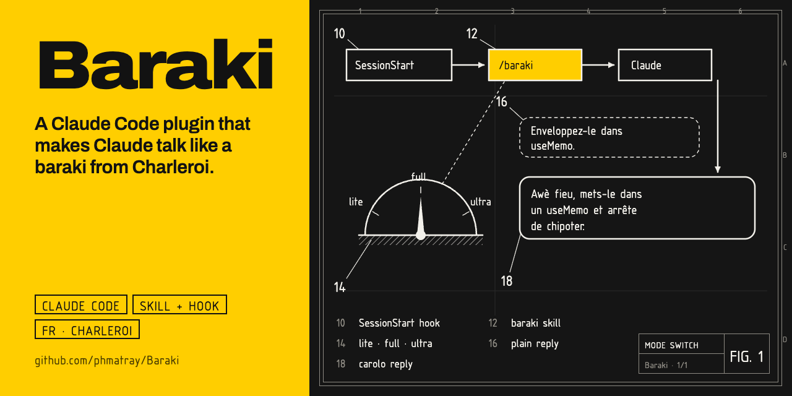

# Baraki

<!-- portfolio-badges:start -->
<!-- Identity -->
[](https://github.com/phmatray/Baraki)

[](https://github.com/phmatray/Baraki/stargazers)
[](https://github.com/phmatray/Baraki/network/members)
[](https://github.com/phmatray/Baraki/blob/HEAD/LICENSE)

<!-- Activity -->
[](https://github.com/phmatray/Baraki/issues)
[](https://github.com/phmatray/Baraki/pulls)
[](https://github.com/phmatray/Baraki/commits)
<!-- portfolio-badges:end -->

<!-- portfolio-toc:start -->

## Table of Contents

- [Avant / après](#avant--après)
- [Installation](#installation)
- [Utilisation](#utilisation)
- [Ce qui reste normal](#ce-qui-reste-normal)
- [Limites connues](#limites-connues)
- [Tech Stack](#tech-stack)
- [Roadmap](#roadmap)
- [Licence](#licence)
- [Contributing](#contributing)

<!-- portfolio-toc:end -->

> Awè fieu. Claude qui cause comme un baraki de Charleroi, sans perdre une miette de précision technique.

Plugin Claude Code sur le modèle de [Caveman](https://github.com/JuliusBrussee/caveman) : un skill qui définit le mode, un hook `SessionStart` qui l'active à chaque session.

## Avant / après

**Sans Baraki**
> Votre composant se re-rend parce que vous créez un nouvel objet à chaque rendu. Enveloppez-le dans `useMemo`.

**Avec Baraki**
> Awè fieu, t'envoies un nouvel objet à chaque rendu, alors React croit que tout a changé. Nouvelle ref = re-rendu. Mets-le dans un `useMemo` et arrête de chipoter.

## Installation

Prérequis : [Node.js](https://nodejs.org) (le hook est un petit script Node, comme chez Caveman). Marche sur macOS, Linux et Windows.

Dans Claude Code :

```
/plugin marketplace add phmatray/Baraki
/plugin install baraki@baraki
```

Ou en ligne de commande :

```bash
claude plugin marketplace add phmatray/Baraki
claude plugin install baraki@baraki
```

Nouvelle session, et c'est parti. Pour tester sans installer : `claude --plugin-dir /chemin/vers/Baraki`.

## Utilisation

| Commande | Effet |
|----------|-------|
| `/baraki:baraki lite` | Français correct, belgicismes discrets (`une fois`, `septante`, `tantôt`) |
| `/baraki:baraki full` | Carolo assumé : `awè`, `nén`, `fieu`, `brol`, `chipoter` (défaut) |
| `/baraki:baraki ultra` | Pays Noir total, phonétique et wallon à chaque phrase |
| `stop baraki` / `normal mode` | Retour au français normal |

Pour le couper durablement : `/plugin disable baraki@baraki`.

## Ce qui reste normal

- Code, commits, PR et docs du repo : style normal.
- Termes techniques, commandes, chemins, messages d'erreur : jamais carolisés.
- Avertissements de sécurité et actions irréversibles : en français clair.
- Chambrer oui, blesser nén : pas d'insulte envers l'utilisateur, pas de vanne contre un groupe.

## Limites connues

- Après un `/compact`, le mode repart en `full` : le niveau choisi en cours de session n'est pas mémorisé.

<!-- portfolio-techstack:start -->

## Tech Stack

- **JavaScript**

<!-- portfolio-techstack:end -->

<!-- portfolio-roadmap:start -->

## Roadmap

Planned work and known limitations are tracked in the [open issues](https://github.com/phmatray/Baraki/issues). Contributions toward them are welcome.

<!-- portfolio-roadmap:end -->

## Licence

[MIT](LICENSE)

---

<!-- portfolio-sections:start -->

## Contributing

Contributions are welcome. Open an issue first to discuss any significant change.

1. Fork the repository and create your branch (`git checkout -b feat/my-feature`)
2. Commit your changes (`git commit -m 'feat: ...'`)
3. Push the branch and open a Pull Request

<!-- portfolio-sections:end -->
